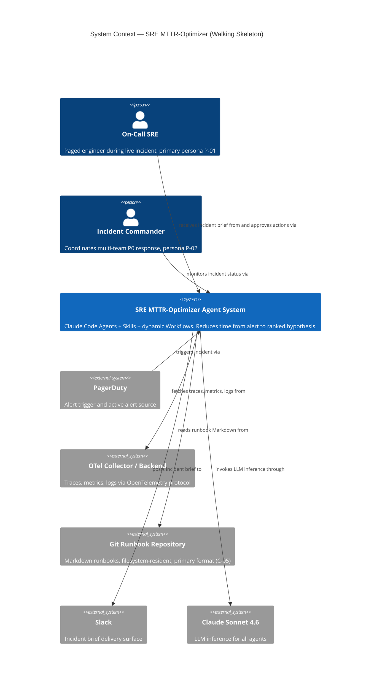
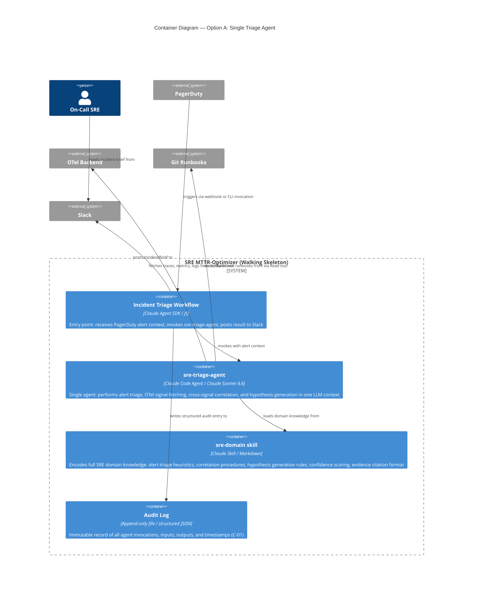
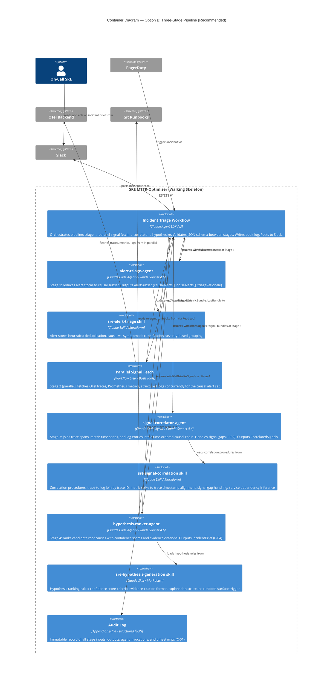
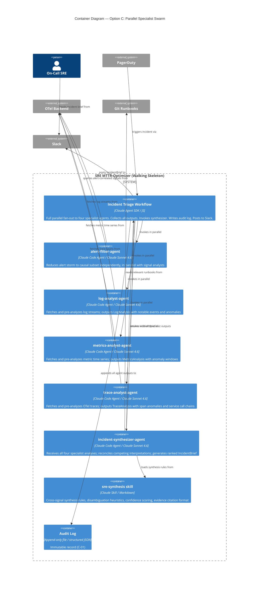

# Architecture Brief — not-so-human-sre / sre-agent-mttr-optimizer

**Wave**: DESIGN
**Date**: 2026-06-23
**Architect**: Morgan (nw-solution-architect)
**Feature ID**: sre-agent-mttr-optimizer
**Interaction Mode**: PROPOSE

---

## System Context and Capabilities

### Problem Being Solved

On-call SREs lose 10–30 minutes per production incident manually correlating logs, metrics, and traces before forming a first diagnostic hypothesis. This manual correlation is the primary MTTR driver (8/10 DISCOVER interviews, validated assumption A-01).

### System Capabilities (Walking Skeleton Scope)

The SRE MTTR-optimizer agent system, in walking skeleton form, delivers:
1. **Alert noise reduction** — reduce a firing alert storm to the causal subset within 60 seconds of incident trigger (OPP-02, ODI-04)
2. **Cross-signal correlation** — automatically join OTel traces, Prometheus metrics, and structured logs into a single causal chain (OPP-01, ODI-03)
3. **Ranked hypothesis generation** — produce a structured incident brief with ranked hypotheses, confidence scores, and evidence citations (OPP-03, ODI-01)

The system operates exclusively in **read-only investigation mode** during the walking skeleton phase. Autonomous execution capabilities (C-01) are out of scope for this design document.

---

## Wave: DESIGN / [REF] DDD List

The domain bounded contexts for the walking skeleton are narrow: this is a single-team, single-product walking skeleton, not a distributed system requiring explicit context mapping. DDD tactical patterns are applied within component boundaries.

| Bounded Context | Responsibility | Ubiquitous Language Key Terms |
|----------------|----------------|-------------------------------|
| **Alert Triage** | Classify a firing alert set into causal, symptomatic, and noise subsets | alert storm, causal alert, symptomatic alert, noise alert, alert group, triage rationale |
| **Signal Correlation** | Join OTel signals (traces, metrics, logs) into a time-ordered causal chain | trace span, trace gap, signal gap, causal chain, correlated event, timeline, service dependency |
| **Hypothesis Generation** | Rank candidate root causes with confidence and evidence | hypothesis, confidence score, evidence citation, incident brief, explanation, ranked hypotheses |
| **Audit Trail** | Record all agent actions and outputs immutably for SRE trust and post-mortem use | audit entry, action log, decision record, read-only action, recommendation event |

---

## Wave: DESIGN / [REF] Component Decomposition

### Walking Skeleton Runtime: Claude Code Agents + Skills + dynamic Workflows

Three architecture options are presented. All share the same external boundary (System Context Level 1). They differ in how the triage/correlation/hypothesis pipeline is decomposed internally (Container Level 2).

---

## C4 System Context (shared by all options)

The external boundary is identical regardless of the internal decomposition option chosen.

---

## Option A: Single Triage Agent (Monolithic)

### Description

One agent handles alert intake, OTel signal fetching, cross-signal correlation, and hypothesis generation in sequence. The Workflow script calls this one agent and extracts a structured `IncidentBrief`.

### C4 Container — Option A

### Option A Trade-offs

| Quality Attribute | Assessment |
|-------------------|------------|
| Development speed | Fastest to first working prototype — one agent, one skill, one workflow |
| Debuggability | Lowest — when output is wrong, the failure could be in triage, correlation, or hypothesis logic; indistinguishable |
| Agent granularity | Coarse — "god agent" pattern; single context holds all three pipeline phases |
| Context window pressure | Highest — alert list + full log batch + trace bundle + metric time series all in one context |
| Mastra port effort | Simplest — one Agent, one workflow step |
| ODI-01 coverage | Partial — hypothesis quality depends on the agent not getting confused by the context breadth |
| ODI-03 coverage | Met — signal consolidation happens, but without enforced phase separation |
| ODI-04 coverage | Met — alert noise reduction is a step in the agent's instructions, but not structurally enforced before correlation |

**Verdict**: Best for a proof-of-concept spike (3–5 days). Not recommended as the walking skeleton for validated agent design.

---

## Option B: Three-Stage Pipeline (Recommended)

### Description

The pipeline is decomposed into three focused agents with a parallel signal-fetching stage between Stage 1 and Stage 3. The Workflow orchestrates them in sequence, passing structured JSON between stages.

### C4 Container — Option B

### Option B Trade-offs

| Quality Attribute | Assessment |
|-------------------|------------|
| Development speed | Moderate — three agents + three skills; estimated 2–3 weeks for walking skeleton |
| Debuggability | High — each stage has a typed output; failure localizes to one stage immediately |
| Agent granularity | Fine — each agent has exactly one semantic responsibility |
| Context window pressure | Bounded per agent — triage agent never sees the full signal bundle; correlator never generates hypotheses |
| Mastra port effort | Mechanical — three agents, four workflow steps, three Zod schemas |
| ODI-01 (time to hypothesis) | Best coverage — hypothesis-ranker-agent is solely focused; no dilution from other concerns |
| ODI-03 (tools/tabs reduction) | Best coverage — parallel signal fetch in Stage 2 eliminates multi-tool manual query |
| ODI-04 (alert noise) | Best coverage — alert-triage-agent structurally isolates noise reduction before correlation begins |
| C-02 (graceful degradation) | Structural — signal gaps are returned as typed fields in the signal fetch output; correlator handles them explicitly |
| C-04 (explainability) | Structural — hypothesis-ranker-agent's Skill defines citation format; output is typed with evidence array |

**Verdict: Recommended.** Balances development speed with the debuggability and isolation needed to validate each ODI in isolation. Cleanest Mastra porting path.

---

## Option C: Parallel Specialist Swarm

### Description

All signal types are processed by dedicated specialist agents simultaneously. A synthesis agent receives all specialist outputs and produces the incident brief.

### C4 Container — Option C

### Option C Trade-offs

| Quality Attribute | Assessment |
|-------------------|------------|
| Development speed | Slowest — five agent system prompts, five skills; estimated 4–6 weeks for walking skeleton |
| Debuggability | Moderate — specialist failures are isolated, but synthesizer failures are opaque (reconciles language-level outputs) |
| Agent granularity | Finest — maximum specialization per signal type |
| Context window pressure | Lowest per specialist — but synthesizer receives four analyses; could be large |
| Mastra port effort | Highest — five agents, parallel workflow fan-out, five Zod schemas |
| ODI-01 (time to hypothesis) | Potentially best wall-clock time due to parallelism, but synthesizer quality risk is high |
| ODI-03 (tools/tabs reduction) | Met — all signal fetching is agent-driven |
| ODI-04 (alert noise) | Risk — alert-filter-agent runs in parallel with signal analysts; analysts may reason over signals correlated to noise alerts |
| LLM cost per incident | Highest — five concurrent agents per incident |

**Verdict**: Appropriate for a mature production system, not for a walking skeleton. The five-agent coordination overhead exceeds the value delivered at this validation stage.

---

## Wave: DESIGN / [REF] Driving Ports

Driving ports define how the system is triggered and how results flow out to humans.

| Port | Description | Contract Shape | Notes |
|------|-------------|---------------|-------|
| `IncidentTriggerPort` | Receives PagerDuty alert context and initiates the triage workflow | pure-function: `trigger(alertContext: AlertContext) → WorkflowRun` — no side effects at port boundary; workflow execution is the only impure function | Read-only driving port; must NOT expose write methods |
| `IncidentBriefDeliveryPort` | Delivers the completed IncidentBrief to the SRE via Slack | bounded-change: declared mutation set = Slack channel message; universe = the designated incident Slack channel | Output-only; never reads from Slack |
| `AuditLogPort` | Appends immutable audit entries for every agent action | bounded-change: append-only; universe = single audit log file; declared delta = one structured JSON entry per agent action, max 4KB per entry (no raw log lines — PII control); file rotation at 100MB; no delete or update operations permitted | Append-only enforced at adapter level; probe must verify write permission + fsync behaviour + rotation trigger |

---

## Wave: DESIGN / [REF] Driven Ports + Adapters

| Port | Adapter | Technology | Probe Requirement (Earned Trust) | Contract Shape |
|------|---------|-----------|----------------------------------|---------------|
| `OtelSignalPort` | `OtelHttpAdapter` | OTel HTTP API / OpenTelemetry JS SDK | `probe()` must: (1) verify OTel endpoint reachable, (2) verify at least one trace exists for a known test service, (3) handle `signal_gap: true` when traces absent | bounded-change: reads only; no write methods on port interface |
| `AlertSourcePort` | `PagerDutyAdapter` | PagerDuty REST API v2 | `probe()` must: (1) verify API key is valid, (2) fetch one alert to confirm response schema matches expected `PagerDutyAlert` type | pure-function: returns alert list; no side effects |
| `RunbookRepositoryPort` | `GitMarkdownAdapter` | Filesystem Read / Git CLI | `probe()` must: (1) verify runbook directory exists and is readable, (2) parse one `.md` file to confirm Markdown parser is operational, (3) detect and report if runbook directory is empty | pure-function: returns parsed runbook content |
| `MetricsPort` | `PrometheusAdapter` | Prometheus HTTP API | `probe()` must: (1) verify Prometheus endpoint reachable, (2) execute one instant-query to confirm response schema | bounded-change: reads only |
| `LogPort` | `OtelLogAdapter` | OTel Log Collector API | `probe()` must: (1) verify log endpoint reachable, (2) fetch one log entry to confirm response schema | bounded-change: reads only |
| `SlackOutputPort` | `SlackWebhookAdapter` | Slack Incoming Webhooks | `probe()` must: (1) post a `[SRE Agent Startup Probe]` message to the configured channel and verify HTTP 200 response | bounded-change: writes to Slack channel only |
| `AuditLogPort` | `FileAuditAdapter` | Append-only JSON file | `probe()` must: (1) verify write permission to audit log directory, (2) append a probe entry (≤4KB) and read it back to confirm fsync behaviour (Docker overlayfs lie: fsync may be a no-op — probe must detect this by comparing pre- and post-fsync file sizes), (3) verify file rotation logic triggers correctly at the 100MB boundary in test mode | bounded-change: append-only; universe = single rotating file; declared delta = max 4KB per entry, no raw log lines (PII rule enforced in adapter, not caller) |

### Composition Root Invariant

Wire → Probe → Use. All adapters must pass their `probe()` before the Workflow accepts its first real alert trigger. If any adapter's `probe()` fails, the system emits a `health.startup.refused` structured event and halts with a non-zero exit code.

### Adapter Probe Enforcement (Three Layers)

Per Principle 13 (Earned Trust), probe contract enforcement uses three semantically orthogonal layers:

1. **Subtype check**: TypeScript interface at composition root verifies every adapter implements `probe(): Promise<ProbeResult>` — caught at compile time
2. **Structural check**: Pre-commit AST hook walks adapter source files and verifies `probe` method presence — caught at commit time
3. **Behavioral check**: CI gold-test runner invokes each adapter's `probe()` against a test double (mock OTel server, mock PagerDuty, local runbook fixture) — caught at CI time

---

## Wave: DESIGN / [REF] Technology Choices

| Component | Technology | License | Rationale |
|-----------|-----------|---------|-----------|
| LLM Runtime | Claude Sonnet 4.6 | Proprietary (Anthropic) | Explicit user requirement; current production model for Claude Code Agents |
| Agent Orchestration | Claude Agent SDK (dynamic Workflows) | Proprietary (Anthropic) | Explicit user requirement for walking skeleton; Workflow tool provides parallel fan-out and structured output |
| Agent Definitions | Claude Code Agents (`.claude/agents/`) | Proprietary (Anthropic) | Explicit user requirement |
| Skills | Claude Skills (`.claude/skills/*.md`) | Proprietary (Anthropic) | Explicit user requirement |
| Output Schema Validation | Zod v4 (already in `package.json`) | MIT | In-project dependency; provides runtime JSON Schema validation for inter-agent handoffs |
| OTel Signal Integration | `@opentelemetry/api` + `@opentelemetry/sdk-node` | Apache 2.0 | Industry standard; 9/10 DISCOVER interviews on OTel; maintained by CNCF |
| PagerDuty Integration | PagerDuty REST API v2 (direct HTTP via fetch) | N/A (API) | No PD client library needed for read-only alert fetching at walking skeleton stage |
| Runbook Parsing | `marked` (Markdown parser) | MIT | Lightweight, well-maintained (5k+ stars), parses Git-resident Markdown (C-05) |
| Audit Logging | `pino` (structured JSON logger) | MIT | Zero-dependency structured logging; append-only file transport; readable output for SRE audit trail |
| Slack Output | Slack Incoming Webhooks (direct HTTP) | N/A | No Slack SDK dependency needed; webhook API is stable and versioned |
| TypeScript | TypeScript ^6.0.3 (already in `devDependencies`) | Apache 2.0 | In-project; type safety for adapter interfaces and schema definitions |
| Architectural Enforcement | `dependency-cruiser` | MIT | Enforces import graph rules: agents may not import each other directly; all inter-agent communication must pass through the Workflow; skills must not import tools |

### Production Target (post-walking-skeleton)

| Component | Mastra Equivalent | Migration Notes |
|-----------|-----------------|-----------------|
| Claude Code Agents | `@mastra/core` `Agent` | Agent system prompts and tool lists port directly |
| Skills | Mastra agent `instructions` + `context` | Skill Markdown content becomes instruction content |
| Workflow JS | `@mastra/core` `createWorkflow()` + `createStep()` | Workflow structure maps 1:1; Zod schemas become step `outputSchema` |
| `pino` audit log | `@mastra/observability` | Mastra's OTel-native span exporter replaces file-based logging |

---

## Wave: DESIGN / [REF] Decisions Table

| Decision | Option A | Option B (Recommended) | Option C | Constraint Addressed |
|----------|----------|------------------------|----------|---------------------|
| Agent count | 1 | 3 | 5 | — |
| Pipeline stages | 1 (sequential) | 4 (incl. parallel fetch) | 2 (parallel + synthesis) | — |
| Alert noise reduction | In-agent instruction | Structurally isolated (Stage 1) | Parallel specialist | C-02, ODI-04 |
| Signal correlation | In-agent instruction | Structurally isolated (Stage 3) | Parallel specialists + synthesis | ODI-03 |
| Hypothesis generation | In-agent instruction | Structurally isolated (Stage 4) | Synthesis agent | ODI-01, C-04 |
| Context window risk | High | Low | Medium | — |
| Dev velocity (weeks) | 0.5–1 | 2–3 | 4–6 | — |
| Debuggability | Low | High | Medium | — |
| Mastra port effort | 1 story | 3 stories | 5 stories | ADR-001 |
| ODI-01 coverage | Partial | Full | Full (risk: synthesis quality) | ODI-01 |
| ODI-04 structural enforcement | None | Stage boundary | Partial (alert agent may not gate signal analysts) | ODI-04 |
| Recommended for | PoC spike | Walking skeleton | Mature production system | — |

**Morgan's Recommendation: Option B — Three-Stage Pipeline**

> The decision is not finalized until the user confirms their selection. ADR-002 status is Proposed until that confirmation. All "Option B" sections below describe the recommended design, not the decided design.

Rationale:
- ODI-01 (score 16.0, highest) is best served by a dedicated `hypothesis-ranker-agent` whose Skill and context is entirely focused on generating ranked, evidence-cited hypotheses. A monolithic agent dilutes this.
- ODI-04 (score 14.5) requires structural enforcement that noise alerts are excluded before signal correlation begins. Only Option B makes this a typed contract between Stage 1 and Stage 3 — Option A and C cannot enforce this structurally.
- Debuggability is critical during the walking skeleton phase: when agent output is incorrect, Option B localizes the failure to one stage immediately. This directly reduces the iteration cycle, which is the primary purpose of the walking skeleton.
- Mastra porting is mechanical for Option B: three agents, four Zod-validated steps, three Skills map directly to Mastra's APIs.
- Option C's parallelism advantage is theoretical — LLM inference for each agent adds latency, and the synthesizer's multi-analysis reconciliation task is harder to prompt correctly than Option B's single-signal-type focus per correlator sub-call.

---

## Wave: DESIGN / [REF] Reuse Analysis

| Existing Component | Path | Relevance | Reuse Decision |
|--------------------|------|-----------|----------------|
| `weather-agent.ts` | `src/mastra/agents/weather-agent.ts` | Weather domain only; Mastra `Agent` API structure is reference for Mastra porting path | No reuse — domain unrelated. Reference only for Mastra agent structure pattern. |
| `weather-tool.ts` | `src/mastra/tools/weather-tool.ts` | Demonstrates `createTool()` pattern; HTTP fetch pattern is reusable concept | No direct reuse — domain unrelated. Tool fetch pattern (HTTP → typed response) informs OTel adapter design. |
| `weather-workflow.ts` | `src/mastra/workflows/weather-workflow.ts` | Demonstrates Mastra `createStep()` and `.then()` chaining; Mastra parallel step pattern | No reuse — Mastra Workflow, not Claude Agent SDK Workflow. Reference for Mastra porting target shape. |
| `weather-scorer.ts` | `src/mastra/scorers/weather-scorer.ts` | Mastra scorer pattern for evaluating agent output quality | No reuse — walking skeleton uses Zod schema validation, not Mastra scorers. Reference for future Mastra port quality layer. |
| `src/mastra/index.ts` | `src/mastra/index.ts` | Mastra registry pattern: how agents, workflows, scorers are registered | No reuse — Mastra-specific registry. The walking skeleton uses Claude Agent SDK, not Mastra's `new Mastra()` registry. |
| `package.json` (zod, typescript) | `package.json` | Zod v4 and TypeScript already present | **REUSE**: Zod v4 used for inter-agent JSON Schema validation in the Workflow. TypeScript used for adapter interface definitions. No new dependencies needed for schema validation. |

**Conclusion**: No existing domain code is reusable. The Mastra scaffolding examples are weather-domain-only and Mastra-framework-specific. They serve as reference patterns for the eventual Mastra port. The only in-project reuse is Zod (already a declared dependency) for JSON Schema validation.

**Justification for new components**: Every new component in the walking skeleton (`alert-triage-agent`, `signal-correlator-agent`, `hypothesis-ranker-agent`, adapter implementations) addresses a domain requirement with no existing alternative in the codebase.

---

## Wave: DESIGN / [REF] Quality Attribute Strategies

### ODI-01: Time to first hypothesis (<5 minutes from page)

- **Strategy**: Three-stage pipeline ensures the hypothesis-ranker-agent receives pre-processed, correlated signals — it does not search raw data. Its Skill defines a structured output format requiring evidence citations per hypothesis, which forces completeness. The Workflow enforces a timeout per stage; if Stage 3 (correlation) exceeds 45s, it returns a partial correlation with `correlation_confidence: low` — hypothesis generation continues with available signals.
- **Measurement**: Workflow emits `workflow.stage.duration_ms` events per stage; total pipeline latency is observable from audit log.

### ODI-03: Multi-tool consolidation

- **Strategy**: Parallel signal fetch in Stage 2 (Option B) eliminates the multi-tab manual process. The SRE receives one structured artifact (IncidentBrief) via Slack containing the synthesized view.
- **Measurement**: Count of external API calls per incident (observable in audit log); SRE does not need to open any additional tool.

### ODI-04: Alert noise reduction

- **Strategy**: `alert-triage-agent` in Stage 1 outputs a typed `AlertSubset` with explicit `noiseAlerts[]` and `triageRationale` fields. The Workflow schema-validates this before passing only `causalAlerts[]` to Stage 2 (signal fetch). This is a structural gate — not a convention.
- **Measurement**: `causalAlerts.length / totalAlerts.length` ratio is included in the IncidentBrief and written to the audit log.

### C-01: Opt-in, reversible, audit-logged autonomy

- **Strategy**: Walking skeleton is read-only. All agent actions are writes to the audit log only (append-only). No remediation tools are available to any agent in the walking skeleton design. The `AuditLogPort` is bounded-change with universe = audit log file.

### C-02: Graceful degradation on incomplete OTel

- **Strategy**: Stage 2 signal fetch returns `signalGap: boolean` and `signalGapReason: string` per signal type. The correlator-agent's Skill includes explicit instructions for reasoning with signal gaps. The IncidentBrief includes `signalCoverage: { traces: boolean, metrics: boolean, logs: boolean }`.

### C-04: Hypothesis explainability

- **Strategy**: hypothesis-ranker-agent's output schema requires `evidence: string[]` per hypothesis — minimum 1 evidence citation. The Skill defines citation format: `"[signal_type] [signal_id]: [observed_value] at [timestamp]"`. Schema validation rejects hypothesis objects without evidence.

### Security

- API keys (PagerDuty, Slack webhook, OTel endpoint auth) stored as environment variables; never embedded in skill files, agent prompts, or committed to Git
- Audit log entries must not contain full raw log lines (PII risk) — only structured summaries; enforced in `FileAuditAdapter` implementation
- Read-only tool scope enforced at walking skeleton stage: no write tools available to any agent

---

## Wave: DESIGN / [REF] Open Questions

| ID | Question | Owner | Impact if Unresolved |
|----|----------|-------|---------------------|
| OQ-01 | What is the OTel backend for testing? A local collector (Jaeger), a cloud backend (Honeycomb, Grafana Cloud), or a mock server? | Engineering | Determines `OtelHttpAdapter` probe implementation and test harness design (P-01 pre-requisite) |
| OQ-02 | What is the PagerDuty alert trigger mechanism for the walking skeleton? Webhook, manual CLI invocation, or simulated alert file? | Engineering | Determines `IncidentTriggerPort` adapter design for the spike |
| OQ-03 | Is there a fixture set of runbooks available for testing? The discovery pre-requisite P-02 calls for 10 representative runbooks. | Product/SRE Domain | Without this, runbook reading cannot be validated in the walking skeleton |
| OQ-04 | What Slack channel and workspace are available for the walking skeleton output? | Engineering | Determines `SlackWebhookAdapter` configuration; if Slack is unavailable, a file-based output adapter should be the walking skeleton default |
| OQ-05 | What is the acceptable LLM cost per incident for the walking skeleton spike? Option B uses 3 agent LLM calls per incident; each call's token count depends on log/trace volume. | Product | Informs whether token budgeting is needed in the Workflow script (P-04 pre-requisite) |
| OQ-06 | Should the walking skeleton support concurrent incidents, or single-incident-at-a-time? | Product | Determines whether Workflow needs session isolation per incident (affects audit log design and agent context isolation) |

---

## External Integrations Requiring Contract Tests

When this system advances to a production deployment stage, the following external integrations require consumer-driven contract tests:

- **PagerDuty REST API v2** (alert list, alert detail endpoints): consumer-driven contracts via Pact-JS in CI acceptance stage. Breaking changes in PagerDuty's alert schema would silently corrupt the `alert-triage-agent` input.
- **OTel Collector HTTP API** (trace, metric, log query endpoints): consumer-driven contracts via Pact-JS. OTel backend API shape varies by vendor (Jaeger vs. Honeycomb vs. Grafana Tempo) — contract tests must be backend-specific.
- **Slack Incoming Webhooks**: contract test must verify webhook payload schema is still accepted (Slack has historically versioned webhook formats).

---

## ADR Index

| ADR | Decision | Status |
|-----|----------|--------|
| ADR-001 | Runtime: Claude Code Agents + Skills + dynamic Workflows vs Mastra.ai | Accepted |
| ADR-002 | Agent decomposition strategy (Options A, B, C) | Proposed — pending user selection |
| ADR-003 | Skill vs. Tool boundary | Accepted |

---

## Architectural Enforcement Tooling

| Rule | Tool | Scope |
|------|------|-------|
| Import graph: agents must not import each other; inter-agent calls only through Workflow | `dependency-cruiser` (MIT) | TypeScript source in `src/` |
| Skill files must not contain executable code blocks | Regex pre-commit hook | `.claude/skills/**/*.md` |
| Every adapter must implement `probe()` | TypeScript interface check at compile time + AST pre-commit hook | `src/adapters/` |
| Inter-agent handoff schema must be Zod-validated | Workflow script runtime assertion | Workflow JS scripts |
| No API keys in `.claude/` files | `git-secrets` or `gitleaks` (MIT) | Entire repository |
